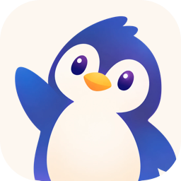
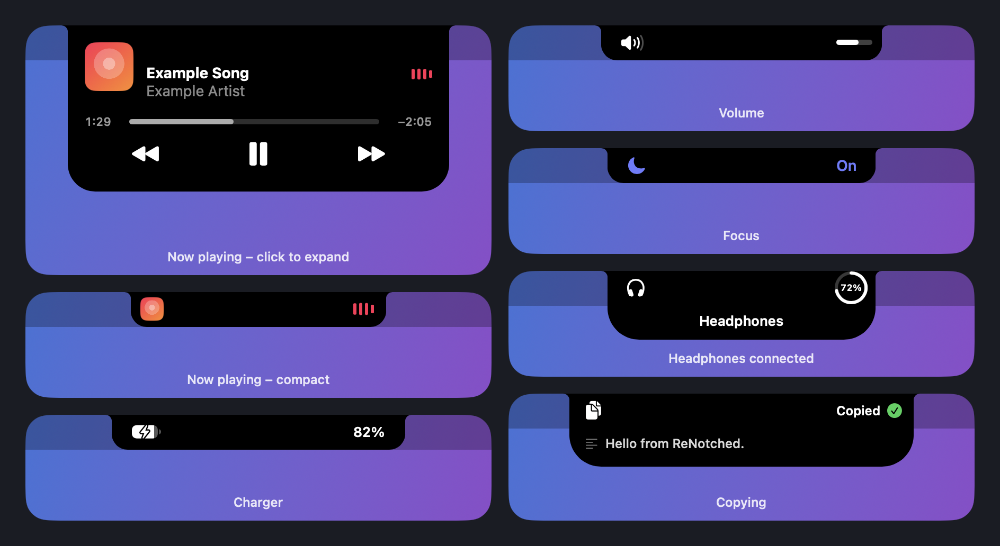
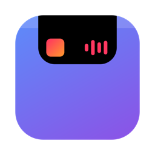

<p align="center">
  <picture>
    <source media="(prefers-color-scheme: dark)" srcset="docs/icon-dark.png">
    
  </picture>
</p>

# ReNotched.

A small, free macOS app that turns the notch of your MacBook into a Dynamic Island – animated feedback for volume, copying, charging and headphones, plus system-wide now-playing with controls.

ReNotched. is deliberately simple. It sticks closely to Apple's design guidelines (system fonts, SF Symbols, native controls, spring animations) and therefore has no crazy features – just the things you glance at every day, done nicely.

The app is available in English and German and picks the language from your system settings.

<p align="center">
  
</p>

## What it shows

- **Volume** – a speaker icon that follows the level, with a level bar next to the notch (also for the volume keys, AirPods and mute, and when you press volume down at 0)
- **Copying** – "Copied" with a preview of the text, file or image. Content marked as confidential by password managers is never previewed
- **Charger** – the battery as macOS shows it, filled to the exact level and with a bolt while charging, when you plug in or unplug the charger
- **Focus** – the mode's icon and "On" or "Off" in the mode's colour (grey when off) when a Focus mode turns on or off, like on the iPhone. This is optional and off by default, because macOS only lets an app read the Focus state with Full Disk Access (see Privacy)
- **Headphones** – connecting Bluetooth headphones shows their name and, if the device reports it, the battery level
- **Now playing** – cover, title, progress and controls for whatever plays on your Mac (Music, Spotify, browsers, …). The equalizer takes the colour of the album cover and a new cover animates in. Click the island to expand it and click anywhere else to close it. When you pause, the cover shrinks and the island closes completely after 30 seconds

The island appears on the built-in display only, never on external monitors, and it slides away with the desktop when an app enters fullscreen and comes back when you leave it.

Each indicator can be switched off in the app's settings window, which is also where you quit the app and enable **Launch at login**.

## How it works

ReNotched. is a SwiftUI and AppKit app that draws a borderless, click-through panel on top of the notch. It reads the notch size from the screen, so the island always lines up with it. Without a notch it appears at the top centre of the screen.

- **Volume** is observed through Core Audio property listeners; the volume keys are watched as well, so pressing them at 0 or at the maximum still shows the island.
- **Copying** is detected by watching the pasteboard change counter twice a second (macOS has no notification for it).
- **Charger** uses IOKit power-source notifications, so there is no polling.
- **Headphones** use IOBluetooth connect notifications.
- **Focus** reads the Focus database in `~/Library/DoNotDisturb/DB` (read-only, change-triggered), which only works once you grant the app Full Disk Access in System Settings.
- **Fullscreen:** the panel lives on one desktop space rather than on all spaces, so a fullscreen space never shows it. After a space change it is moved to the new desktop, unless that space is a fullscreen one. That check is a read-only query of the active space type (a private CoreGraphics call used only for this).
- **Now playing** is read with the third-party [mediaremote-adapter](https://github.com/ungive/mediaremote-adapter), because Apple restricted the private MediaRemote interface for regular apps in macOS 15.4. It runs as one long-lived helper process that only reports changes.

## Requirements

- macOS 26 or later on Apple silicon (the settings window uses Liquid Glass)
- Xcode 26 or later (or a matching Swift toolchain) to build it
- A MacBook with a notch is recommended

## Install

1. Download the latest `ReNotched-<version>.zip` from the [Releases](../../releases) page and unzip it.
2. Move `ReNotched..app` to your Applications folder. The file name ends in a dot on purpose, so Finder and the Dock show "ReNotched."
3. The app is signed locally (ad hoc) and not notarized by Apple, because that needs a paid developer account. The first start is therefore blocked: open **System Settings → Privacy & Security**, scroll down and click **Open Anyway**, or run `xattr -dr com.apple.quarantine /Applications/ReNotched..app` in Terminal. You only have to do this once.

Release builds are for Apple silicon, which all MacBooks with a notch use.

## Build and run

```bash
./build.sh && open build/ReNotched..app
```

The build script compiles the Swift package, assembles the app bundle and signs it locally (ad hoc), so no Apple Developer account is needed. To use it every day, drag `build/ReNotched..app` to your Applications folder. The file name ends in a dot on purpose, so Finder and the Dock show the name "ReNotched."

If you want to ship your own build, change the bundle identifier (`com.renotched.ReNotched`) in `Info.plist` and sign with your own team.

## Project structure

```
Sources/ReNotched/
  main.swift                 entry point
  App/                       app delegate, the panel over the notch (placement, clicks, fullscreen)
  Model/                     IslandModel (what the island shows) and Track
  Monitors/                  one file per source: volume, clipboard, power, Bluetooth, Focus, now playing, spaces
  Views/                     the island and one view per indicator; Views/Music for the player
  Settings/                  settings window and preferences
Vendor/                      mediaremote-adapter (BSD-3)
Resources/                   app icons (Icon Composer format; penguin default, island alternative) and German strings
```

## Usage

1. Open the app once. Its settings window lets you choose which indicators you want. Closing that window leaves the app running in the background without a Dock icon. To open the settings again (or to quit with the power button in the window), open the app a second time from Finder or Spotlight.
2. macOS asks for **Bluetooth** access. This is only used to notice when headphones connect. Without it, the headphone indicator stays off.
3. Play music, change the volume or copy something – the island reacts on its own. Click the island while music is playing to open the player.

## App icon

The default icon is a waving penguin. An alternative icon with the notch and a small player (the original design) can be chosen in the settings: click the app icon at the top of the settings window to open the **App icon** choice. It becomes the Dock icon while the app runs and is remembered. The icon of the app file itself (Finder) is set when building: `./build.sh` uses the penguin, `ICON=island ./build.sh` the alternative one.

<p align="center">
  <picture>
    <source media="(prefers-color-scheme: dark)" srcset="docs/icon-dark.png">
    
  </picture>
  &nbsp;&nbsp;
  <picture>
    <source media="(prefers-color-scheme: dark)" srcset="docs/icon-island-dark.png">
    
  </picture>
</p>

Both icons follow the system's light and dark appearance. The penguin illustration was generated with an AI image tool (ChatGPT). The artwork comes from `Tools/penguin-source.png`, which `swift Tools/make-penguin-layer.swift` cuts out and places on the icon canvas, and from `swift Tools/make-icon.swift` for the alternative. The README images with the Liquid Glass look come from `Tools/make-icon-previews.sh` (Icon Composer's `ictool`), the social preview from `swift Tools/make-social-preview.swift`.

## Privacy

ReNotched. does not collect, store or send any personal data. It has no accounts, analytics, advertising or tracking and makes no network connections.

- **Clipboard:** the copied text, file name or image type is read only to show the preview on the island. It is kept in memory for a moment and never saved.
- **Now playing:** title, artist, cover and progress come from macOS and are shown locally only.
- **Focus (optional):** if you enable it and grant Full Disk Access, the app reads the name of the active Focus mode from the system's Focus database, only to show it. It reads nothing else in that folder and never stores or sends it. Leave it off and no access is needed.
- **Bluetooth:** device names and battery levels are read only to show them when headphones connect.
- **Stored on your Mac:** only your on/off choices in the app's preferences. Delete the preferences to remove them.

## Legal

- ReNotched. is an independent project. It is **not affiliated with, authorised or endorsed by Apple Inc.** Apple, MacBook, macOS, Dynamic Island and SF Symbols are trademarks of Apple Inc.
- The software is provided **as is, without warranty of any kind** (see [LICENSE](LICENSE)). Use it at your own risk.
- Fullscreen detection uses a private CoreGraphics call, and now-playing information uses the private MediaRemote interface through the bundled [mediaremote-adapter](https://github.com/ungive/mediaremote-adapter) (BSD-3-Clause, © Jonas van den Berg and contributors, see `Vendor/MediaRemoteAdapter.LICENSE`; the pinned source and how to rebuild the binary are described in `Vendor/README.md`). Private interfaces can change or stop working with any macOS update, and apps that use them cannot be distributed through the Mac App Store.
- SF Symbols are used as permitted by Apple's SF Symbols license for apps running on Apple platforms.

## License

MIT – see [LICENSE](LICENSE). Third-party components keep their own licenses.
