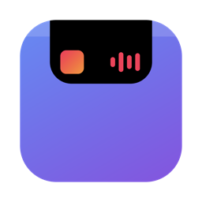

<p align="center">
  
</p>

# ReNotched.

A small, free macOS app that turns the notch of your MacBook into a Dynamic Island – animated feedback for volume, copying, charging and headphones, plus system-wide now-playing with controls.

ReNotched. is deliberately simple. It sticks closely to Apple's design guidelines (system fonts, SF Symbols, native controls, spring animations) and therefore has no crazy features – just the things you glance at every day, done nicely.

The app is available in English and German and picks the language from your system settings.

## What it shows

- **Volume** – a speaker icon that follows the level, with a level bar next to the notch (also for the volume keys, AirPods and mute)
- **Copying** – "Copied" with a preview of the text, file or image. Content marked as confidential by password managers is never previewed
- **Charger** – a bolt and the battery level when you plug in or unplug the charger
- **Headphones** – connecting Bluetooth headphones shows their name and, if the device reports it, the battery level
- **Now playing** – cover, title, progress and controls for whatever plays on your Mac (Music, Spotify, browsers, …). The equalizer and progress bar use the colour of the album cover and a new cover animates in. Click the island to expand it and click anywhere else to close it. When you pause, the cover shrinks and the island closes completely after 30 seconds

Each indicator can be switched off in the app's settings window, which is also where you quit the app and enable **Launch at login**.

## How it works

ReNotched. is a SwiftUI and AppKit app that draws a borderless, click-through panel on top of the notch. It reads the notch size from the screen, so the island always lines up with it. Without a notch it appears at the top centre of the screen.

- **Volume** is observed through Core Audio property listeners.
- **Copying** is detected by watching the pasteboard change counter a few times per second.
- **Charger** uses IOKit power-source notifications, so there is no polling.
- **Headphones** use IOBluetooth connect notifications.
- **Now playing** is read with the third-party [mediaremote-adapter](https://github.com/ungive/mediaremote-adapter), because Apple restricted the private MediaRemote interface for regular apps in macOS 15.4. It runs as one long-lived helper process that only reports changes.

## Requirements

- macOS 26 or later (the settings window uses Liquid Glass)
- Xcode 26 or later (or a matching Swift toolchain) to build it
- A MacBook with a notch is recommended

## Build and run

```bash
./build.sh && open build/ReNotched..app
```

The build script compiles the Swift package, assembles the app bundle and signs it locally (ad hoc), so no Apple Developer account is needed. To use it every day, drag `build/ReNotched..app` to your Applications folder. The file name ends in a dot on purpose, so Finder and the Dock show the name "ReNotched."

If you want to ship your own build, change the bundle identifier (`com.renotched.ReNotched`) in `Info.plist` and sign with your own team.

## Usage

1. Open the app once. Its settings window lets you choose which indicators you want.
2. macOS asks for **Bluetooth** access. This is only used to notice when headphones connect. Without it, the headphone indicator stays off.
3. Play music, change the volume or copy something – the island reacts on its own. Click the island while music is playing to open the player.

## Privacy

ReNotched. does not collect, store or send any personal data. It has no accounts, analytics, advertising or tracking and makes no network connections.

- **Clipboard:** the copied text, file name or image type is read only to show the preview on the island. It is kept in memory for a moment and never saved.
- **Now playing:** title, artist, cover and progress come from macOS and are shown locally only.
- **Bluetooth:** device names and battery levels are read only to show them when headphones connect.
- **Stored on your Mac:** only your on/off choices in the app's preferences. Delete the preferences to remove them.

## Legal

- ReNotched. is an independent project. It is **not affiliated with, authorised or endorsed by Apple Inc.** Apple, MacBook, macOS, Dynamic Island and SF Symbols are trademarks of Apple Inc.
- The software is provided **as is, without warranty of any kind** (see [LICENSE](LICENSE)). Use it at your own risk.
- Now-playing information uses a private macOS interface through the bundled [mediaremote-adapter](https://github.com/ungive/mediaremote-adapter) (BSD-3-Clause, © Jonas van den Berg and contributors, see `Vendor/MediaRemoteAdapter.LICENSE`). Private interfaces can change or stop working with any macOS update, and apps that use them cannot be distributed through the Mac App Store.
- SF Symbols are used as permitted by Apple's SF Symbols license for apps running on Apple platforms.

## License

MIT – see [LICENSE](LICENSE). Third-party components keep their own licenses. The app icon can be regenerated with `swift Tools/make-icon.swift`.
